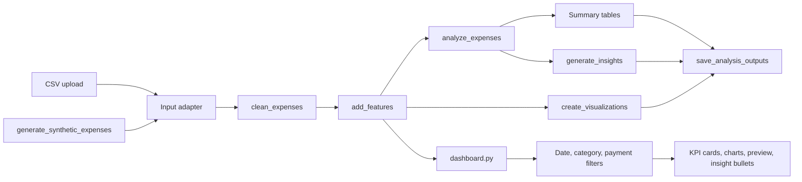

# Expense Tracker App

A portfolio-ready data analytics project that turns expense records into a
clean, explainable, and presentation-friendly analysis. The project combines a
small public core API with an optional Streamlit dashboard. It demonstrates
data cleaning, feature engineering, exploratory analysis, visualization,
insight writing, reproducible outputs, and a clear path from exploration to a
usable application.

> **Core contract:** the implementation is expected to expose
> `generate_synthetic_expenses`, `clean_expenses`, `add_features`,
> `analyze_expenses`, `create_visualizations`, `generate_insights`, and
> `save_analysis_outputs`. Keep these public names stable when connecting the
> dashboard or extending the project.

## 1. What the project does

### Simple explanation

People often know that they spend money, but not where, when, or how. The
Expense Tracker App accepts transaction records, fixes common data-quality
issues, groups spending into useful views, and explains the most important
patterns. A user can inspect totals by category, see how spending changes over
time, compare payment methods, and read short generated insights.

### Technical explanation

The application is a reproducible analytics pipeline around a tabular expense
dataset. It generates or ingests rows, normalizes dates and amounts, handles
invalid values, derives time features such as month, computes aggregate
summaries, creates charts, generates narrative insights, and saves
machine-readable and presentation-ready artifacts. The optional
`dashboard.py` is a Streamlit adapter that applies interactive filters to the
same canonical fields:

- `date`: transaction date or timestamp
- `amount`: positive numeric spend amount after cleaning (refunds are out of scope for this beginner demo)
- `category`: spending group
- `payment_method`: payment channel
- optional `description`: human-readable transaction note

### Why it matters and who can use it

- **Students:** a compact project that demonstrates an end-to-end data
  workflow rather than a collection of disconnected charts.
- **Individuals:** a starting point for understanding spending patterns.
- **Small teams:** a simple monthly reporting template for operational costs.
- **Analysts:** a clean example of separating ingestion, transformation,
  analysis, presentation, and output persistence.
- **Hiring managers:** an easy-to-review portfolio artifact with a visible
  problem, measurable outputs, and explainable assumptions.

The default dataset is synthetic, so it is safe to publish and reproducible.
It is not a substitute for a bank-grade accounting or forecasting system.

### Role alignment

- **Data Analyst:** clean a transactional table, calculate KPIs, reconcile
  grouped totals, and communicate trends with charts.
- **Business Analyst:** translate spending patterns into budget questions,
  operational follow-ups, and stakeholder-friendly recommendations.
- **Financial Analyst:** compare actuals with illustrative budgets, inspect
  variance by category/month, and explain the limits of descriptive analysis.

### Real-world use cases

- **Personal finance tracking:** understand where monthly income is going and
  identify recurring or discretionary spending.
- **Business expense monitoring:** compare operating costs by department,
  category, merchant, or payment channel.
- **Budgeting and cost control:** compare actual spending with a budget and
  flag categories that need attention.
- **Financial planning:** use historical summaries to support savings goals,
  cash-flow conversations, and scenario planning. The current project is
  descriptive; it does not provide financial advice.

## 2. Project workflow

```text
CSV upload or synthetic generator
              |
              v
     DataFrame / CSV input storage
              |
              v
        clean_expenses
              |
              v
          add_features
              |
              v
         analyze_expenses
          /           \\
         v             v
create_visualizations  generate_insights
          \\           /
           v         v
      save_analysis_outputs
              |
              v
    CSV / JSON / text / PNG artifacts
              |
              v
     Optional Streamlit dashboard
```

The result moves from storage to analysis to decision-making: a reader can
compare actual spend with category budgets, identify an unusually expensive
month, and decide what deserves review. The dashboard uses the core module when
it is importable. If the core module
is not connected yet, it uses a clearly labeled deterministic preview
generator so the presentation layer can still be demonstrated. Set
`EXPENSE_TRACKER_MODULE` to the import path of a differently named core module.

## 3. Recommended tech-stack options

| Option | Tools | Dashboard/app? | Difficulty | Best for |
| --- | --- | --- | --- | --- |
| **A — Recommended student option** | Python, pandas, NumPy, Matplotlib/Seaborn, optional Streamlit, pytest, Git/GitHub | Yes — Streamlit | Easy to intermediate | A strong first portfolio project with a complete analysis-to-app story |
| **B — Notebook-first** | Python, pandas, Jupyter, Matplotlib/Seaborn, Markdown, Git/GitHub | No — notebook and saved charts | Easy | Learning analysis interactively and explaining each step |
| **C — Advanced production-leaning** | Python, pandas, FastAPI, PostgreSQL, React, Docker, pytest, CI/CD | Yes — API plus web frontend | Advanced | Practicing multi-user architecture, deployment, persistence, and APIs |

**Recommendation:** choose Option A. It gives a student a complete story—data
quality, analysis, visual communication, and an interactive demo—without
hiding the core logic inside a large framework. Add an API or database only
after the pipeline and acceptance criteria are stable.

## 4. Architecture



### Suggested boundaries

1. **Core module:** owns data transformations and analysis; it should not
   depend on Streamlit widgets.
2. **Output layer:** owns stable filenames and serializable artifacts.
3. **Dashboard:** owns interaction and display; it should call core functions
   instead of duplicating business rules.
4. **Documentation:** explains how to reproduce the result and discuss design
   decisions in an interview.

## 5. Phase-wise build plan

The following sequence matches the requested beginner-friendly progression. Each
phase leaves a visible artifact that can be shown in a GitHub commit or interview.

| Phase | What to do | Why | Expected output | Mistake to avoid |
| --- | --- | --- | --- | --- |
| 1. Setup | Create a virtual environment, install packages, define the schema, and run a smoke check. | A known environment prevents confusing setup failures. | Working Python command, `requirements.txt`, and project folders. | Installing packages globally and not recording versions. |
| 2. Data creation/input | Generate deterministic synthetic rows or accept a CSV with date, category, amount, and payment method. | Safe, reproducible input makes the project publishable. | Raw DataFrame/CSV and a documented schema. | Using unseeded random data or hiding the input assumptions. |
| 3. Cleaning | Parse dates and amounts, fill safe labels, remove invalid rows and duplicates. | Unclean data produces misleading metrics. | `cleaned_expenses.csv` and tests for invalid rows. | Silently changing values or treating invalid amounts as zero. |
| 4. EDA | Inspect row counts, categories, distributions, missing values, and grouped totals. | EDA helps find patterns and data-quality problems before modeling. | Summary tables and an EDA notebook/console view. | Making a chart without stating the question it answers. |
| 5. Feature engineering | Add month, weekday, weekend, and other fields tied to a question. | Shared features make time and behavior analysis consistent. | Featured DataFrame with documented columns. | Adding many features that are never used. |
| 6. Analysis | Calculate KPIs, category/month/payment summaries, and budget status. | Aggregation converts rows into decisions. | CSV summaries, `kpis.json`, and reconciliation checks. | Double-counting rows or sorting months alphabetically. |
| 7. Visualization | Create labeled bar, pie, line, payment-method, and weekday charts. | Visuals make the strongest patterns easy to scan. | PNG files with units, titles, and readable labels. | Decorative charts with unclear units or truncated context. |
| 8. Insights | Translate the strongest descriptive results into evidence-based bullets. | Stakeholders need an interpretation, not only a table. | `insights.txt` and dashboard insight bullets. | Claiming causation or financial advice from synthetic data. |
| 9. GitHub upload | Run tests, capture screenshots, review `.gitignore`, commit in focused steps, and push. | Reproducibility and proof make the project credible to reviewers. | Public repository, README, screenshots, and clean history. | Uploading private data, caches, or code that was never run. |

See [PROJECT_PLAN.md](PROJECT_PLAN.md) for the detailed roadmap and acceptance
criteria.

## 6. Suggested folder structure

The exact core layout may differ. This is a recommended GitHub-ready shape
that also matches a common `src` package layout:

```text
Expense-Tracker-App/
├── data/                         # optional local/raw CSV input
├── notebooks/                    # optional learning notebooks
├── src/                          # reusable pipeline code
│   ├── __init__.py
│   └── expense_tracker.py
├── outputs/                      # generated CSV/JSON/text reports
├── images/                       # generated charts and screenshots
├── tests/                        # focused automated tests
├── dashboard.py                  # optional Streamlit dashboard
├── main.py                       # command-line entry point
├── README.md                     # project explanation and run guide
├── requirements.txt              # Python dependencies
├── GITHUB_GUIDE.md               # repository and commit instructions
├── PROJECT_PLAN.md               # phases and acceptance criteria
├── INTERVIEW_PREP.md             # interview questions and answers
└── .gitignore                    # excludes environments and caches
```

`data/` is available for a user-provided CSV, `notebooks/` is an optional
learning space, `src/` contains testable business logic, `outputs/` stores
machine-readable reports, and `images/` stores presentation assets. Keeping
`main.py` and `dashboard.py` thin makes it easier to reuse the same pipeline in
a notebook, a scheduled report, or a future API.


The generated CSV/JSON/PNG artifacts are reproducible and can be regenerated
with the commands below. The repository keeps code and documentation under
version control while the `.gitignore` prevents accidental commits of local
caches or private data.

## 7. Installation

Use a virtual environment so dependencies stay isolated.

### Windows PowerShell

```powershell
cd "C:\path\to\Expense Tracker App"
py -3 -m venv .venv
.\.venv\Scripts\Activate.ps1
python -m pip install --upgrade pip
python -m pip install -r requirements.txt
python -m pip install streamlit  # optional dashboard
```

If PowerShell blocks activation for the current user, use Command Prompt:

```bat
.venv\Scripts\activate.bat
```

### macOS

```bash
cd "/path/to/Expense Tracker App"
python3 -m venv .venv
source .venv/bin/activate
python -m pip install --upgrade pip
python -m pip install -r requirements.txt
python -m pip install streamlit  # optional dashboard
```

### Linux

```bash
cd "/path/to/Expense Tracker App"
python3 -m venv .venv
source .venv/bin/activate
python -m pip install --upgrade pip
python -m pip install -r requirements.txt
python -m pip install streamlit  # optional dashboard
```

Streamlit is optional for the pipeline. The dashboard checks for it only when
run and prints an installation hint instead of failing at import time.

## 8. Run commands

### Run the core pipeline

From the project directory with the virtual environment active:

```bash
python main.py
```

Useful variations:

```bash
python main.py --rows 1000 --seed 7
python main.py --no-quality-issues
python main.py --output-dir outputs/demo --image-dir images/demo
```

The default run generates 720 raw synthetic rows, intentionally includes a few
quality issues for the cleaning demonstration, cleans the data, calculates
summaries, writes insight text, and creates static charts. The same pipeline can
be called from Python:

```python
from src.expense_tracker import (
    add_features, analyze_expenses, clean_expenses,
    create_visualizations, generate_insights,
    generate_synthetic_expenses, save_analysis_outputs,
)

raw = generate_synthetic_expenses(n_rows=300, seed=42)
cleaned = clean_expenses(raw)
featured = add_features(cleaned)
analysis = analyze_expenses(featured)
create_visualizations(featured, analysis)
insights = generate_insights(featured, analysis)
save_analysis_outputs(cleaned, analysis, insights)
```

### Run the optional dashboard

Install Streamlit once if needed, then run from the project directory:

```bash
python -m pip install streamlit
python -m streamlit run dashboard.py
```

The sidebar provides two paths:

1. **Generate synthetic data:** choose the number of rows and use the
   reproducible core generator or dashboard preview fallback.
2. **Upload CSV:** provide a CSV containing `date`, `amount`, `category`, and
   `payment_method`. Common aliases such as `transaction_date`, `cost`,
   `expense_category`, and `payment_type` are recognized.

The app displays date, category, and payment-method filters; total spend,
transaction count, average transaction, and top category KPI cards; category,
monthly, and payment-method charts; a filtered preview; and generated insight
bullets. Use `EXPENSE_TRACKER_MODULE` when the core module has another import
name:

```bash
# macOS/Linux
EXPENSE_TRACKER_MODULE=my_package.expense_tracker python -m streamlit run dashboard.py

# Windows PowerShell
$env:EXPENSE_TRACKER_MODULE = "my_package.expense_tracker"
python -m streamlit run dashboard.py
```

### Run tests and syntax checks

```bash
python -m pytest -q
python -m py_compile main.py src/expense_tracker.py dashboard.py
```

The tests cover deterministic generation, invalid-row cleaning, duplicate
handling, KPI reconciliation, and insight text. The syntax check catches a
broken Python file before you publish it.

## 9. Virtual simulation walkthrough

This project behaves like a small financial reporting simulation. The data is
not real, but the workflow mirrors a real analyst's process:

1. **Generate the input:** `generate_synthetic_expenses(n_rows=720, seed=42)`
   creates one row per synthetic expense with a date, category, description,
   amount, payment method, and merchant. Categories such as Food, Housing,
   Transportation, Utilities, Shopping, Travel, Education, Healthcare,
   Entertainment, and Other are sampled with different probabilities and
   amount scales so the data has visible variation.
2. **Inject a cleaning exercise:** the default generator adds a duplicate ID,
   one negative amount, one missing category, and one missing date. This makes
   the data-quality step visible rather than pretending input is always clean.
3. **Clean the rows:** `clean_expenses` parses dates and numbers, supplies safe
   labels for optional text fields, removes invalid/non-positive rows, removes
   duplicate records, sorts by date, and produces the canonical table. In the
   default run, 720 raw rows become 716 valid rows.
4. **Create analytical features:** `add_features` derives month, month start,
   year, month name, weekday, weekend flag, and day of month. These fields let
   the analysis group transactions consistently.
5. **Aggregate the behavior:** `analyze_expenses` calculates total spend,
   counts, averages, category shares, monthly trends, payment-method totals,
   weekday totals, and illustrative budget utilization. A category is marked
   **Over budget** when its actual spend is greater than its budget for the
   observed number of months.
6. **Visualize the patterns:** the pipeline writes a category bar chart, a
   category-share pie chart, monthly line chart, payment-method bar chart, and
   weekday bar chart. The charts answer where, when, and how spending occurs.
7. **Write decisions-ready insights:** `generate_insights` turns the strongest
   computed patterns into short bullets such as the top category, highest-spend
   month, over-budget category, and highest-spend weekday. A human can then ask
   follow-up questions such as “Should the Food or Shopping budget change?”

The exact simulation is reproducible: run the same command with the same seed to
get the same row values and summary totals. Save the terminal output, the CSV
summaries, the five PNG charts, `kpis.json`, and `insights.txt` as proof that the
pipeline ran end to end. For a portfolio screenshot, show the cleaned dataset
preview, one category chart, the monthly trend, the pie chart, and the
Streamlit dashboard after changing at least one filter.

## 10. Expected results and output filenames

A successful pipeline run should produce numeric summaries that reconcile with
the cleaned data. The recommended stable output contract is:

```text
outputs/
├── cleaned_expenses.csv
├── category_summary.csv
├── monthly_summary.csv
├── payment_summary.csv
├── weekday_summary.csv
├── budget_status.csv
├── kpis.json
├── insights.txt
└── analysis.json
images/
├── spending_by_category.png
├── spending_by_category_pie.png
├── monthly_spending.png
├── spending_by_payment_method.png
└── spending_by_weekday.png
```

These names match the expected core `save_analysis_outputs` and
`create_visualizations` results. Recommended contents:

- `cleaned_expenses.csv`: validated rows and canonical column names.
- `category_summary.csv`: spend and transaction count per category.
- `monthly_summary.csv`: spend and transaction count by calendar month.
- `payment_summary.csv`: spend and count by payment method.
- `weekday_summary.csv`: spend and count by day of week.
- `budget_status.csv`: category budget comparisons, when configured.
- `kpis.json`: machine-readable total, count, average, and related KPIs.
- `insights.txt`: evidence-based insight bullets for a reader.
- `analysis.json`: serializable copies of the aggregate analysis tables.
- `images/*.png`: reproducible static charts for README or presentations.

An orchestration script may additionally save `raw_expenses.csv` and
`featured_expenses.csv`; those are useful audit artifacts but are not required
by the core output saver.

For the current default run (`python main.py` with seed `42`), the verified
example is 720 raw rows to 716 cleaned rows, total spend of `$87,518.63`,
an average transaction of `$122.23`, and `Housing` as the largest category.
Your values will change when you intentionally change `--rows` or `--seed`.

The exact values depend on the random seed and record count. A useful quality
check is:

```text
total spend in cleaned_expenses.csv
  = sum of category_summary.csv
  = sum of monthly_summary.csv
  = sum of payment_summary.csv
```

Allow for rounding differences only at the final display step. If the existing
core module intentionally uses a different filename, document that mapping in
its README section rather than silently publishing an inaccurate list.

## 11. Screenshot checklist

Before publishing, capture screenshots that prove the project works:

- [ ] Dataset preview showing the raw/cleaned columns and at least five rows.
- [ ] Dashboard overview with title and four KPI cards visible.
- [ ] Sidebar showing synthetic/upload source and all three filter types.
- [ ] Category spend bar chart with readable labels and currency meaning.
- [ ] Category share pie chart with a clear legend or labels.
- [ ] Monthly trend line chart spanning more than one month.
- [ ] Payment-method chart and filtered data preview.
- [ ] Insight bullets that refer to the selected data.
- [ ] A second view after changing date/category/payment filters.
- [ ] A meaningful empty state or invalid-CSV message, if implemented.
- [ ] README image captions that say what each screenshot proves.
- [ ] No personal financial records, API keys, or local absolute paths.

Suggested image names are `dashboard-overview.png`, `dashboard-filters.png`,
and `dashboard-insights.png`. Store them in `images/` or `docs/images/` and
link them with relative Markdown paths.

## 12. GitHub upload steps

Choose a clear repository identity:

- **Repository name:** `expense-tracker-app`
- **Description:** `A reproducible Python expense analytics pipeline with an optional Streamlit dashboard.`
- **Suggested tags/topics:** `python`, `pandas`, `data-analysis`,
  `data-visualization`, `streamlit`, `expense-tracker`, `portfolio-project`,
  `beginner-data-science`

Exact commands and a commit-message plan are in
[GITHUB_GUIDE.md](GITHUB_GUIDE.md). The short version is:

```bash
git init
git branch -M main
git add .
git diff --cached --stat
git diff --cached --check
git commit -m "feat: add expense tracker analytics pipeline"
git remote add origin https://github.com/YOUR_USERNAME/expense-tracker-app.git
git push -u origin main
```

Do not commit `.venv/`, secrets, raw private financial data, generated caches,
or large unreviewed output folders. Add or review a suitable `.gitignore` in
the core project before the first real commit.

## 13. Five-day proof-building plan

| Day | Focus | Proof to finish |
| --- | --- | --- |
| 1 | Setup | Virtual environment, requirements, folders, and first smoke check |
| 2 | Dataset | Synthetic generator, schema, seed, and dataset preview screenshot |
| 3 | Analysis | Cleaning, feature engineering, reconciled summaries, and tests |
| 4 | Visualization | Static charts, dashboard filters, insight bullets, and screenshots |
| 5 | Final upload | README walkthrough, focused commits, interview rehearsal, and GitHub push |

Each day should end with a visible artifact. That habit makes the project easy
to explain and gives a reviewer evidence beyond source code.

## 14. Interview quick links

- [Interview questions and strong answers](INTERVIEW_PREP.md)
- [Phase roadmap and acceptance criteria](PROJECT_PLAN.md)
- [Exact Git commands and commit plan](GITHUB_GUIDE.md)
- [Streamlit documentation](https://docs.streamlit.io/)
- [pandas documentation](https://pandas.pydata.org/docs/)
- [Python virtual environments](https://docs.python.org/3/library/venv.html)

## 15. Future improvements

- Add user-selectable currency and locale-aware formatting.
- Add budget targets and variance-to-budget indicators.
- Support recurring transactions and merchant normalization.
- Add anomaly detection with transparent thresholds.
- Add month-over-month and rolling-average comparisons.
- Add export buttons for filtered data and PDF/HTML reports.
- Add stronger schema validation and a downloadable data-quality report.
- Add automated tests for each public function and output reconciliation.
- Add a database/API layer only when multi-user persistence is needed.
- Add a mobile-friendly app or responsive front end for on-the-go entry.
- Add real-time transaction sync when a trusted data source is available.
- Add AI-based spending prediction, budgeting alerts, and financial goal tracking
  with transparent evaluation and opt-in user data.
- Add CI for formatting, tests, and a dashboard smoke check.

## 16. Troubleshooting

### `ModuleNotFoundError: No module named 'pandas'`

Activate the virtual environment and run:

```bash
python -m pip install pandas
```

### Streamlit is missing

The dashboard is optional. Install its dependencies and rerun:

```bash
python -m pip install streamlit pandas
python -m streamlit run dashboard.py
```

If Streamlit is not installed, running `python dashboard.py` directly prints a
clear installation hint. When Streamlit is installed, prefer the supported
`python -m streamlit run dashboard.py` command so the app has a Streamlit runtime.

### The dashboard says the core module is not found

Put the module on the current Python path, use the recommended `src` layout,
or set `EXPENSE_TRACKER_MODULE` to its dotted import path. The dashboard can
still show deterministic preview data while the core is connected.

### CSV validation fails

Ensure the file has `date`, `amount`, `category`, and `payment_method` columns
(case and spacing can vary). Amounts may contain currency symbols or commas.
Remove rows with dates or amounts that cannot be interpreted.

### Charts are empty

Check the selected date range and multiselect values. If every option was
removed, restore the selections. Confirm that the amount column contains
numeric values after cleaning.

### GitHub rejects a push

Check the remote URL and authentication, then run:

```bash
git remote -v
git status
git pull --rebase origin main
```

Resolve conflicts, review the diff, and push again.

## 17. Limitations and synthetic-data note

Synthetic data is useful for reproducible demonstrations, but it does not
represent a real person's financial behavior. It can miss seasonality,
merchant-specific patterns, refunds, transfers, shared bills, currency
conversion, tax rules, and privacy concerns. Descriptive summaries show
associations in the supplied rows; they do not prove causes or predict future
spending. Before using real data, add consent, redaction, secure storage,
validation, currency handling, and tests for the domain rules that matter.
